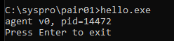
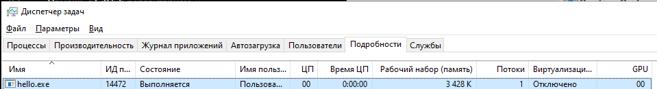
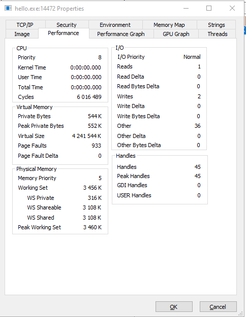
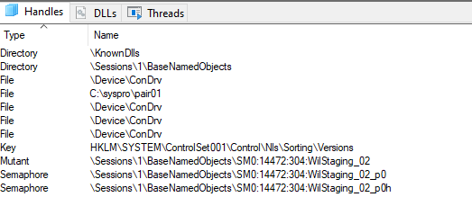
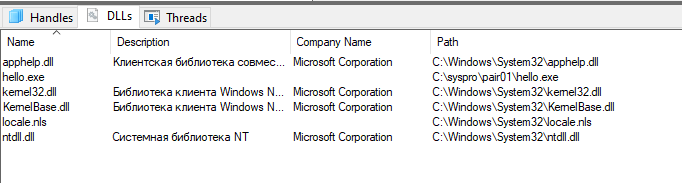
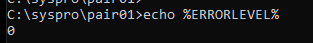
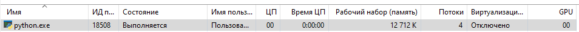
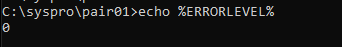

# ЛР 1. Процесс изнутри

Система: Windows · компилятор: Оптимизирующий компилятор Microsoft (R) C/C++ версии 19.50.35724 для x64

## Программа на C

Программа напечатала PID 14472, монитор показал PID 14472. Память процесса в мониторе: 3428 КБ. Процессорное время: 0:00:00. Пока программа ждёт Enter, процессорное время не растёт, потому что процесс ожидает ввод с клавиатуры и не выполняет вычисления.

Дескрипторов у процесса: 45. Ввод и вывод ведут в устройство консоли Windows \Device\ConDrv. Системные библиотеки в процессе: apphelp.dll, kernel32.dll, KernelBase.dll, ntdll.dll, msvcrt.dll.

После завершения из монитора терминал напечатал приглашение C:\syspro\pair01>, код завершения 0.

## Программа на Python

Имя процесса в мониторе: python.exe, PID 13484, память 12628 КБ. Памяти больше, чем у программы на C, примерно в 3,68 раза. Общая библиотека у программ на C и Python: kernel32.dll. Код завершения при обычном выходе: 0.

Не получилось: существенных затруднений не возникло.

## Снимки экрана

### 1. Программа на C запущена

### 2. Свой процесс в мониторе

### 3. Свойства процесса

### 4. Дескрипторы процесса

### 5. Библиотеки процесса

### 6. Процесс завершён из монитора

### 7. Программа на Python в мониторе

### 8. Обычный выход

