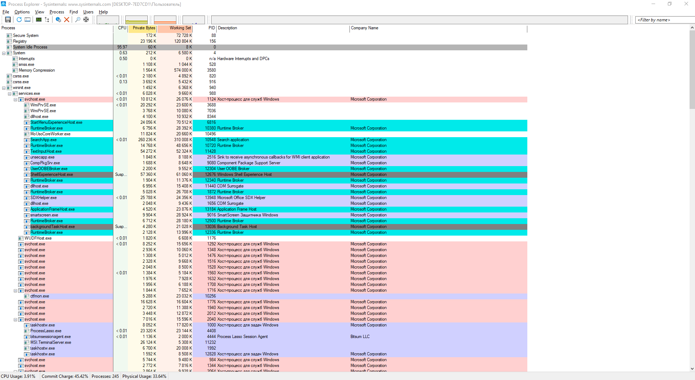
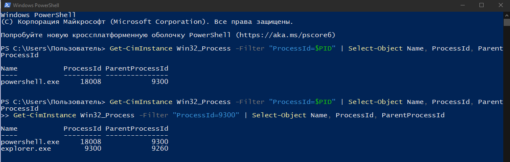
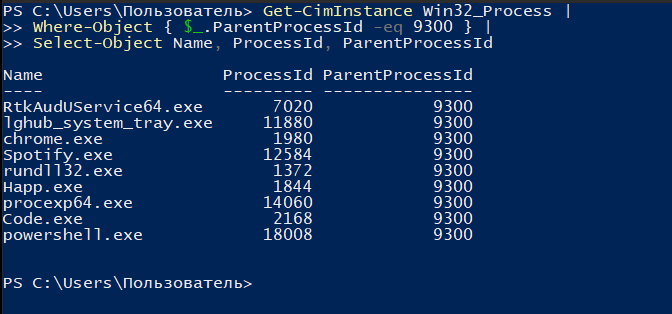
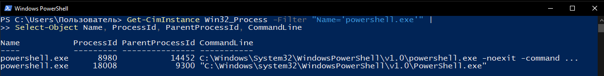
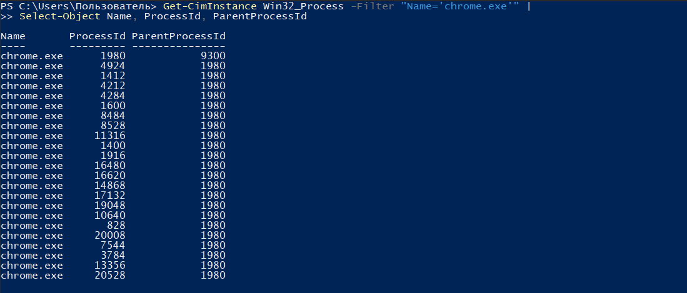
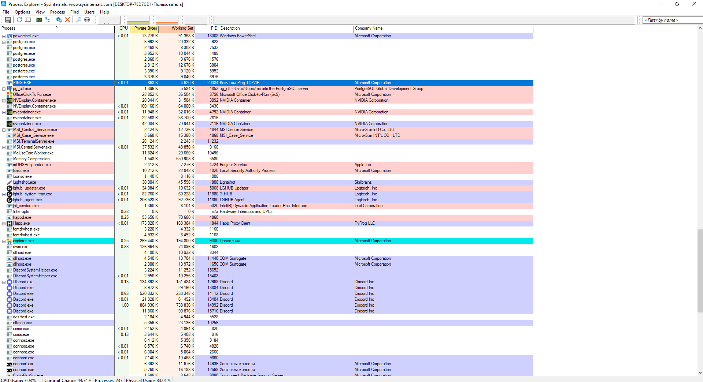

# ЛР 4. Дерево процессов

Система: Windows

## Дерево

Процесс в начале дерева и его номер: System Idle Process — PID 0; System — PID 4.

Цепочка родителей терминала (имя и номер: explorer.exe (PID 9300) → powershell.exe (PID 18008).

Дочерний процесс: powershell.exe, номер **18008**, родитель **explorer.exe (PID 9300)**.

Команда, которой проверен родитель: `Get-CimInstance Win32_Process -Filter "ProcessId=$PID" | Select-Object Name, ProcessId, ParentProcessId`

Процессов у браузера и имя процесса вкладок: 23 процесса Google Chrome. Основной процесс — chrome.exe (PID 1980). Дочерние процессы, включая процессы вкладок, — chrome.exe.

## Сирота

Номер сироты: 20384 (PING.EXE).

Номер родителя до и после завершения настоящего родителя: 17892. После завершения родительского процесса значение ParentProcessId у PING.EXE осталось 17892, хотя процесс с таким PID уже отсутствовал.

Где сирота стоит в дереве: PING.EXE отображается в Process Explorer отдельно от исходного родителя, который завершил работу.

Не получилось: В третьем задании вместо процесса, запущенного непосредственно из терминала, были исследованы дочерние процессы explorer.exe. Остальные эксперименты выполнены.

## Снимки экрана

Снимки экрана сохранены в папке `screenshots/`.

### 1. Начало дерева процессов

Шаг 1. Видно: дерево процессов в мониторе, первые процессы системы и их номера.

### 2. Терминал и его родители

Шаг 2. Видно: родительские процессы терминала PowerShell.

### 3. Дочерний процесс терминала

Шаг 3. Видно: список дочерних процессов explorer.exe, полученный через PowerShell.

### 4. Родитель по команде

Шаг 4. Видно: вывод команды с номером процесса и номером его родителя.

### 5. Процессы браузера

Шаг 5. Видно: процессы браузера Google Chrome и их родительские PID.

### 6. Процесс без родителя

Шаг 6. Видно: процесс PING.EXE (PID 20384) и проверка отсутствия его родителя (PID 17892).

### 7. Сирота в дереве

Шаг 7. Видно: процесс PING.EXE в Process Explorer после завершения его родительского процесса.

