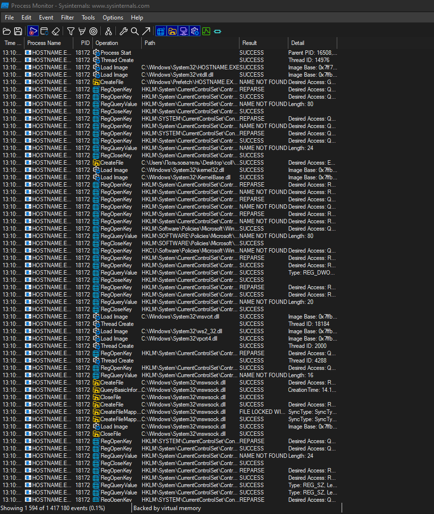
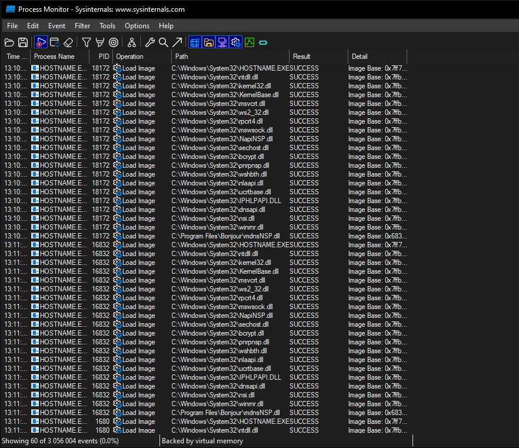
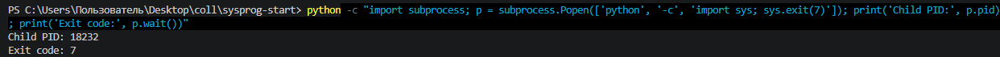
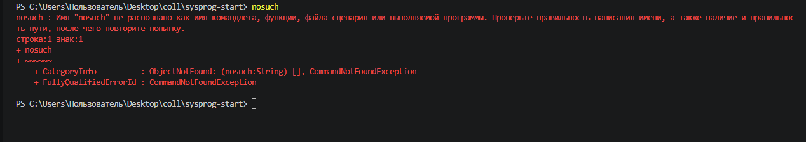
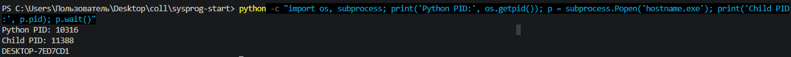

# ЛР 5. Рождение процесса

Система: Windows  
Программа записи: Process Monitor (Sysinternals)

## Рождение

Родитель (имя и номер): powershell.exe (PID 16508, по событию Process Start).

Номер нового процесса: 18172 (HOSTNAME.EXE).

Событие или вызов, которым создан процесс: Process Start (создание процесса через механизм CreateProcess Windows).

Библиотек загружено и первая из них: 18 DLL, первая — ntdll.dll. Перед библиотеками также загружен образ HOSTNAME.EXE.

## Завершение

Код завершения у ребёнка и у родителя: дочерний Python-процесс завершился с кодом 7. Родительский Python-процесс получил код 7 через `p.wait()` и вывел его в терминал. Код завершения самого родителя отдельно не проверялся.

Программа nosuch: папок проверено 29, ошибка CommandNotFoundException, код False (PowerShell $?).

## Запуск из Python

Номер Python и номер ребёнка: Python — PID 10316, дочерний hostname.exe — PID 11388.

Чем запуск из Python отличается от запуска из оболочки: при запуске из PowerShell родителем нового процесса выступает оболочка PowerShell. При запуске через `subprocess.Popen()` родительским процессом является Python, который может получить PID ребёнка и дождаться его завершения через `wait()`.

Не получилось: не подсчитано количество папок PATH при поиске nosuch; не проверены код ошибки команды nosuch и код завершения родительского Python-процесса.

## Снимки экрана

Снимки экрана сохранены в папке `screenshots/`.

### 1. Рождение процесса

Шаг 1. Видно: событие Process Start для HOSTNAME.EXE (PID 18172), Parent PID 16508.

### 2. Библиотеки нового процесса

Шаг 2. Видно: события Load Image, загруженные DLL и первая библиотека ntdll.dll.

### 3. Код завершения 7

Шаг 3. Видно: дочерний Python-процесс (PID 18232) завершился с кодом 7, родитель получил код через p.wait().

### 4. Программы нет

Шаг 4. Видно: попытка запуска nosuch в PowerShell и ошибка CommandNotFoundException.

### 5. Запуск из Python

Шаг 5. Видно: Python (PID 10316) запускает hostname.exe (PID 11388).

