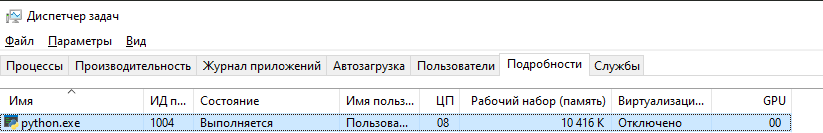
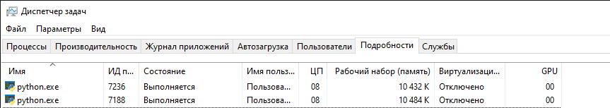
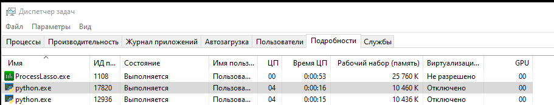
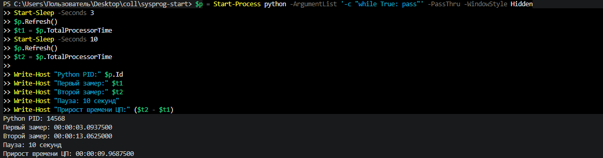

# ЛР 6. Кто загружает процессор

Система: Windows 10

Ядер (логических процессоров): 6 физических ядер, 12 логических процессоров. Процессор Intel Core i5-12400F.

## Одна нагрузка

Процент процесса в мониторе: 8%.

Общая загрузка: точное значение при первом запуске не зафиксировано. Во время последующего эксперимента с одним Python-процессом общая загрузка составляла 31%, включая остальные процессы системы.

На каких ядрах видна нагрузка: нагрузка наблюдалась на нескольких логических процессорах. Windows может перемещать выполняющийся поток между логическими процессорами. В Диспетчере задач отображались графики всех 12 логических процессоров.

## Две нагрузки

Проценты обеих нагрузок и общая загрузка: два процесса Python использовали примерно по 8% ЦП каждый. Их суммарная нагрузка составляла около 16% общей вычислительной мощности процессора. Точная общая загрузка компьютера не зафиксирована.

На одном ядре (в macOS — фоновый режим): два процесса Python (PID 17820 и 12936) были закреплены за одним логическим процессором. Каждый использовал примерно 4% ЦП. Процессы делили процессорное время одного логического процессора между собой.

## Процессорное время

Первый замер, второй замер, пауза: первый замер — 3,09375 с; второй замер — 13,0625 с; пауза — 10 секунд. Прирост процессорного времени составил 9,96875 с. PID процесса — 14568.

Загрузка по замерам: примерно 99,7% одного логического процессора, или около 8,3% суммарной мощности 12 логических процессоров.

Почему процент в мониторе не говорит о скорости работы: процент загрузки показывает долю времени использования процессора, а не количество выполненных операций. Скорость выполнения программы зависит от производительности процессора, его частоты, архитектуры, количества ядер, планировщика операционной системы и характера вычислений. Поэтому одинаковая загрузка ЦП на разных компьютерах не означает одинаковую скорость работы.

Не получилось: точные значения общей загрузки компьютера при первых экспериментах не были зафиксированы. Остальные эксперименты выполнены.

## Снимки экрана

Снимки экрана сохранены в папке `screenshots/`.

### 1. Одна нагрузка

Шаг 1. Видно: процесс Python с загрузкой около 8% ЦП.

### 2. Две нагрузки

Шаг 3. Видно: два процесса Python, каждый использует примерно 8% ЦП.

### 3. Нагрузки на одном ядре

Шаг 4. Видно: два процесса Python (PID 17820 и 12936), закреплённые за одним логическим процессором. Каждый использует примерно 4% ЦП.

### 4. Процессорное время

Шаг 5. Видно: два замера процессорного времени Python (PID 14568) с паузой 10 секунд. Первый замер — 3,09375 с, второй — 13,0625 с. Прирост — 9,96875 с.

