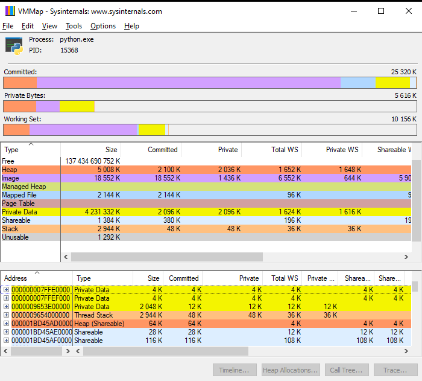
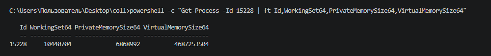
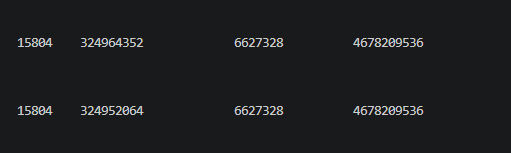
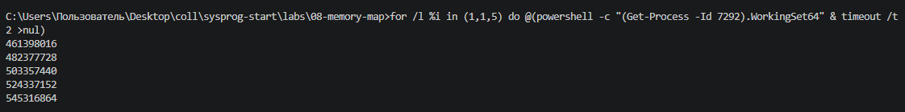

# ЛР 8. Карта памяти

Система: Windows 10 x64  
Чем мерил (виртуальная и занятая): VMMap и PowerShell (Get-Process).

## Этапы mem.py

Старт: PID 15368, Committed = 25 320 KB, Private Bytes = 5 616 KB, Working Set = 10 156 KB.

Получил 300 МБ: PID 15228, Working Set = 10 440 704 байта, Private Memory = 6 868 992 байта.

Записал в каждую страницу: PID 15804, Working Set = 324 964 352 байта (примерно 310 МБ).

Освободил: программа вывела `4. freed` и завершилась.

Почему занятая память выросла только на третьем этапе: выделение виртуальной памяти резервирует адресное пространство, но физические страницы начинают реально использоваться при обращении к ним и записи данных.

## Карта памяти

Из каких частей состоит память процесса: Free, Heap, Image, Managed Heap, Mapped File, Page Table, Private Data, Shareable, Stack и Unusable.

## Утечка

Пять замеров leak.py (PID 7292):

1. 461398016 байт
2. 482377728 байт
3. 503357440 байт
4. 524337152 байт
5. 545316864 байт

На сколько росла память за 2 секунды: 20 979 712 байт.

Не получилось: первоначально не успевал сделать снимки до завершения этапов mem.py, поэтому повторно запускал программу для получения нужных результатов.

## Снимки экрана

### 1. Карта памяти

### 2. Получено 300 МБ

### 3. Страницы заняты

### 4. Утечка
