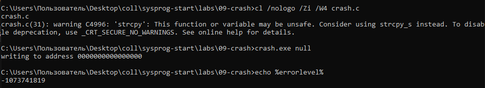
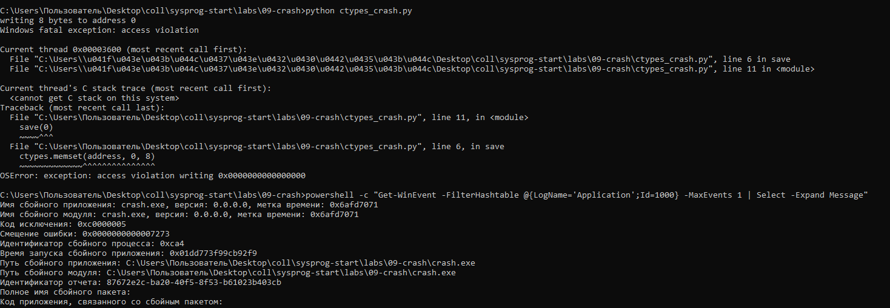
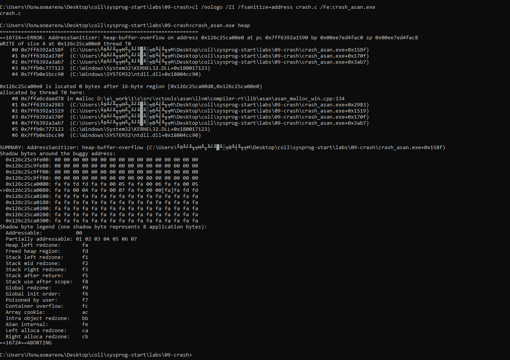
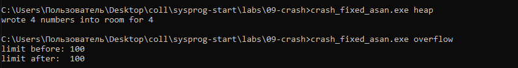

# ЛР 9. Разбор падения

Система: Windows 10 x64  
Компилятор: Microsoft Visual C/C++ Compiler (MSVC).

## Падение

crash null: программа напечатала `writing to address 0000000000000000`. Код завершения: `-1073741819` (`0xC0000005`) — ошибка доступа к памяти (Access Violation).

ctypes_crash.py: Python напечатал `writing 8 bytes to address 0`, затем `Windows fatal exception: access violation`. Возникло исключение `OSError: exception: access violation writing 0x0000000000000000`.

Где система записала падение: журнал Windows Application, событие 1000. В записи указан сбой приложения `crash.exe` и код исключения `0xc0000005`.

## Молчаливые ошибки

crash overflow: limit до записи — 100, после записи — 7. Код завершения — 0. Запись за границу массива повредила соседнюю переменную.

crash heap без проверки: программа записывает 5 чисел в область памяти, выделенную для 4 чисел.

AddressSanitizer для heap: обнаружена ошибка `heap-buffer-overflow`, запись размером 4 байта за пределами выделенного блока размером 16 байт. Ошибка возникает при записи `data[i]` (строка 24 исходного файла).

AddressSanitizer для uaf: обнаружена ошибка `heap-use-after-free`. Произошло чтение освобождённой памяти (`READ of size 2`). Память размером 16 байт была выделена через `malloc`, затем освобождена через `free(name)` (строка 32), после чего программа попыталась прочитать её через `printf` (строка 33).

## Исправление

Что изменено: исправлена граница цикла — условие `i <= 4` заменено на `i < 4`.

Исправленная программа напечатала:

`wrote 4 numbers into room for 4`

`limit before: 100`

`limit after:  100`

Ошибок AddressSanitizer при проверке исправленных режимов heap и overflow не обнаружено.

Не получилось: для получения некоторых результатов потребовалось повторно запускать программы.

## Снимки экрана

### 1. Падение

### 2. Падение Python

### 3. Отчёт AddressSanitizer

### 4. Исправление
